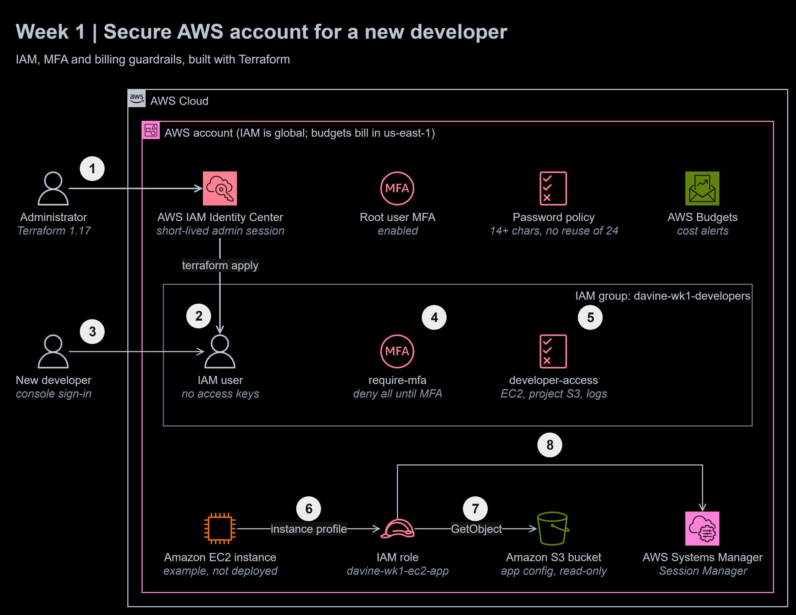
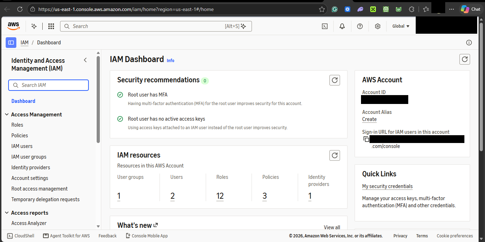
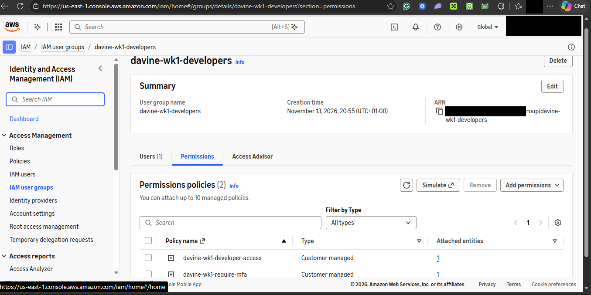
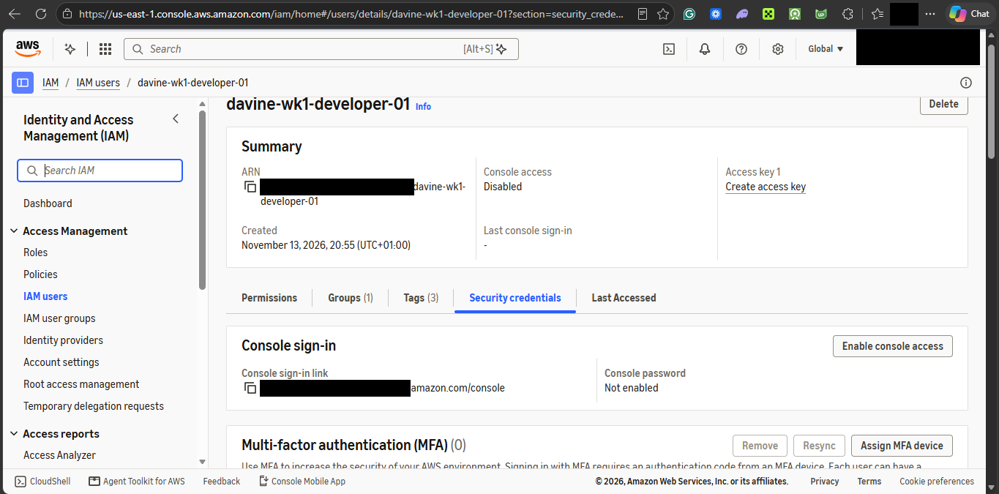
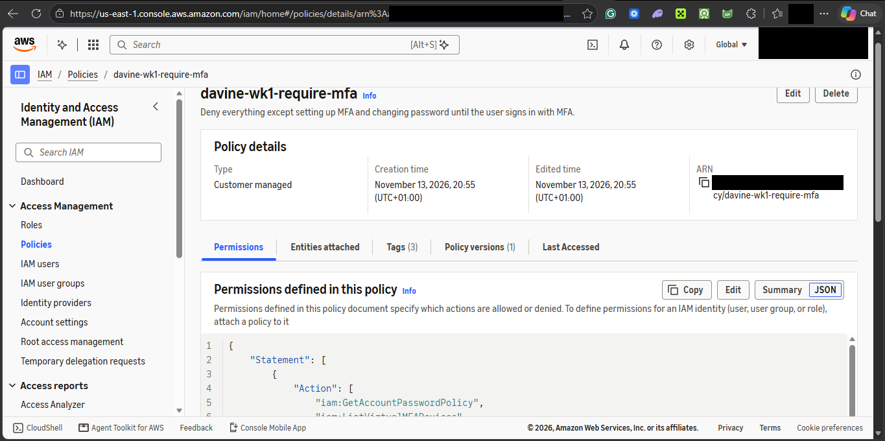
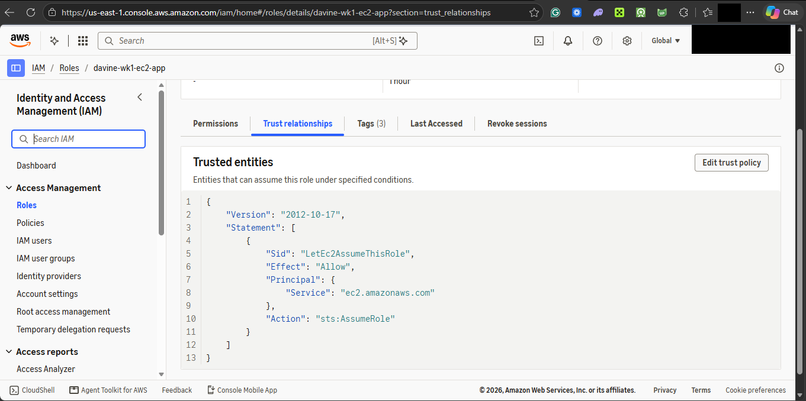
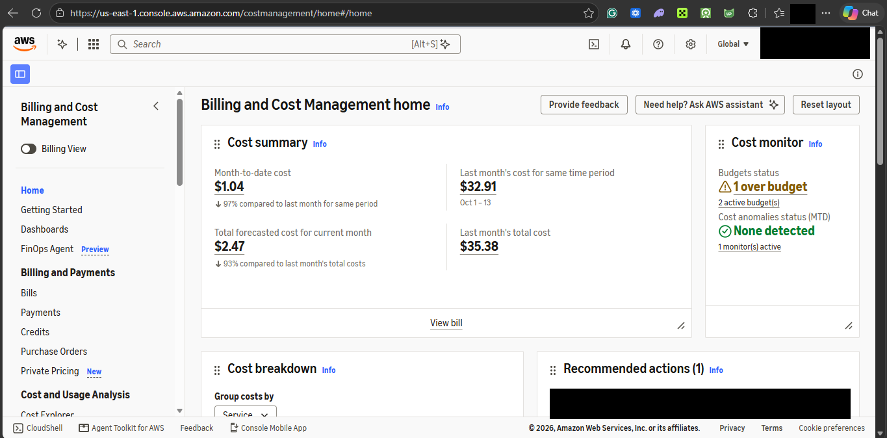

# Secure AWS Account Setup with IAM and MFA


**Exercise date:** week of 10 August 2026 | **Type:** Davine Technologies Internship Project, AWS Cloud internship week 1 lab | **Status:** rebuilt as tested Terraform; applied, verified and destroyed on 13 November 2026

> **Evaluation project.** A learning task completed for the Davine Technologies internship programme, rebuilt for this repository in my own AWS account. The lab user and role exist only for the length of a test run. It is not a production setup and contains no company data.

**At a glance**

- **Outcome:** a new developer gets an AWS identity that can do nothing useful until they turn on MFA, and then only their job; an application gets a role instead of access keys.
- **Built:** Terraform for a password policy, a Developers group with two customer managed policies, an IAM user with no access keys, and an EC2 role with an instance profile; four policy files; a live verification script; a [concepts report](docs/report.md) ([PDF](docs/report.pdf)); an [AI verification log](docs/ai-verification-log.md).
- **Stack:** Terraform 1.17 (AWS provider 6.73), AWS IAM, IAM Identity Center, IAM Access Analyzer, AWS Budgets, AWS CLI v2, TFLint, Checkov, Trivy, gitleaks, GitHub Actions.
- **Proof:** on 13 November 2026, 13 resources were applied through an Identity Center session, and 23 of 23 live checks passed: 19 IAM policy simulations (for example, the same action is allowed with MFA and explicitly denied without it) and 0 Access Analyzer findings on all 4 policies. 10 of 10 Terraform tests pass on every push. Everything was destroyed at 21:52 the same evening.



To zoom in, right-click the diagram and open the image in a new tab. The editable source is [`docs/diagrams/iam-onboarding.drawio`](docs/diagrams/iam-onboarding.drawio).

1. The **administrator** signs in through **IAM Identity Center**, which issues short-lived credentials. No long-term admin keys exist.
2. `terraform apply` creates the **password policy**, the **Developers group** with its two policies, and the **IAM user**.
3. The **new developer** signs in with a one-time password.
4. Until they register an MFA device, **require-mfa** denies everything except changing that password and setting up MFA.
5. With MFA, **developer-access** lets them read EC2 and metrics, start and stop instances tagged `Team=developers`, use `davine-wk1-dev-*` buckets, and read `/davine-wk1/` logs.
6. An application on **EC2** gets the **IAM role** through an instance profile, with temporary credentials that rotate on their own.
7. The role can only **read** its config bucket.
8. It can also register with **Systems Manager**, so the instance is reached through Session Manager instead of SSH.

Root user MFA, the password policy and AWS Budgets are account guardrails that every identity sits behind.

## The task, in my own words

Set up a new AWS account the way a cloud engineer would for a new hire: lock down the root user with MFA, put the developer in a group rather than granting permissions one by one, give them only what the job needs, create a role so an AWS service never needs stored keys, and keep an eye on billing. Then explain the cloud and IAM concepts behind it, and check what an AI assistant says about them against AWS itself.

## What I did in the internship, and what this repository is

I completed this week in August 2026 in the AWS console and submitted a report and screenshots to the programme. I did not keep copies, so for this repository I rebuilt the whole setup as Terraform and ran it again on 13 November 2026. Every screenshot and transcript here comes from that run, and the commit dates are the real dates of this rebuild.

## The rebuilt solution

| Path | What it holds |
|---|---|
| [`policies/`](policies) | the four IAM policies as plain JSON, exactly as AWS receives them |
| [`terraform/`](terraform) | the 13 resources ([`iam.tf`](terraform/iam.tf), [`budget.tf`](terraform/budget.tf)) and the tests ([`tests/iam.tftest.hcl`](terraform/tests/iam.tftest.hcl)) |
| [`scripts/verify_live.sh`](scripts/verify_live.sh) | asks IAM what each identity may do, validates every policy, collects account evidence |
| [`docs/`](docs) | [report](docs/report.md), [implementation steps](docs/implementation.md), [testing](docs/testing.md), [AI verification log](docs/ai-verification-log.md), [live run transcript](docs/evidence/live-run-2026-11-13.txt) |
| [`screenshots/`](screenshots) | redacted console evidence |

| Policy | Attached to | What it does |
|---|---|---|
| [`require-mfa`](policies/require-mfa.json) | Developers group | denies every action except MFA setup and changing your own password whenever `aws:MultiFactorAuthPresent` is false |
| [`developer-access`](policies/developer-access.json) | Developers group | read EC2 and CloudWatch metrics; start, stop and reboot only `Team=developers` instances; read and write only `davine-wk1-dev-*` buckets; read only `/davine-wk1/` logs |
| [`ec2-trust`](policies/ec2-trust.json) | the role's trust policy | only `ec2.amazonaws.com` may assume the role |
| [`ec2-app-config-read`](policies/ec2-app-config-read.json) | EC2 role | list and read one bucket, `davine-wk1-dev-app-config`; nothing else in S3 |

The role also carries AWS's `AmazonSSMManagedInstanceCore`. A monthly budget (alerts at 80% of actual and 100% of forecast spend) is built only when `budget_alert_email` is set; my account already had two budgets, so the live run did not add one. No EC2 instance or S3 bucket was created: the policy simulator tests the permissions against those resource names without either needing to exist.

### Running it

```bash
aws sso login --profile <admin-profile> && export AWS_PROFILE=<admin-profile>
cd terraform && terraform init && terraform apply     # 13 resources
../scripts/verify_live.sh                             # 23 live checks
terraform destroy
```

The full walkthrough, including the console steps that deliberately stay out of code, is [docs/implementation.md](docs/implementation.md).

## How it is tested

**Tested on every push** by GitHub Actions, with no AWS credentials: the 4 policy files parse as JSON, a guard confirms no access keys or console passwords are created in code, Terraform format and validate pass, **10 of 10 Terraform tests pass** against a mocked provider, TFLint reports 0 issues, Checkov passes 25 checks with 1 justified skip, Trivy reports 0 findings with 1 justified ignore, and gitleaks finds no secrets in the history.

To prove the tests catch real mistakes, I broke a copy three ways (MFA deny flipped, trust given to Lambda, `iam:CreateUser` added for developers). Each break failed the suite.

**Tested live on AWS** on 13 November 2026 at 20:55 WAT: **23 passed, 0 failed**. The developer may describe instances with MFA (`allowed`) but not without it (`explicitDeny`); may stop a `Team=developers` instance but not a `Team=finance` one; may never create IAM users or attach policies to itself; and before MFA may change their password and register a device, but not remove one. The role may read its config object but not overwrite it, and may register with Systems Manager. IAM Access Analyzer returned 0 findings on each policy. Details are in [docs/testing.md](docs/testing.md).

## Screenshots

From the 13 November 2026 run, with the account ID and email redacted.













Also: [Console Home](screenshots/01-console-home.png) and [the budgets list](screenshots/08-budgets.png).

## Mistakes I fixed

1. **A test claimed more than it checked.** I first named a test "joins the group and gets no keys", but nothing in it looked at keys. I renamed it, and the no-keys guarantee is now checked for real: a CI guard fails the build if `aws_iam_access_key` or a login profile appears in the code, and the live run confirms 0 access keys.
2. **A scanner ignore did nothing.** My first Trivy ignore comment had a line of explanation between it and the resource, so Trivy never applied it. It must sit directly above the block; the explanation now comes first.
3. **The AI's first draft had two wrong examples.** Amazon Chime, now discontinued, appeared as a SaaS example, and Lambda as PaaS. Checking against AWS caught both; see [the verification log](docs/ai-verification-log.md).

## Traps I avoided

- **A password in Terraform ends up in the state file**, so the developer's first password is a console step, not code.
- **`terraform destroy` removes the account password policy**, so I checked first that the account had none (`NoSuchEntity`); destroying returns it to exactly its earlier state.
- **`${aws:username}` in a resource ARN does not match users on a path**, so the users have no path and the require-MFA statements match them.
- **Root MFA cannot be set through an API.** It was already enabled, and the run reads `AccountMFAEnabled: 1` instead of pretending to manage it.

## Lab vs production

| Concern | In this module | Before going to production | Well-Architected pillar |
|---|---|---|---|
| How people sign in | an IAM user with a password and MFA, because the brief asks for one | IAM Identity Center for every person, with permission sets and temporary credentials; I already run Terraform this way | Security |
| Guardrails across accounts | one account, policies only | AWS Organizations with service control policies and permission boundaries | Security |
| Unused access | none tracked | IAM Access Analyzer unused-access findings reviewed monthly | Security |
| Audit | default CloudTrail event history | an organization trail to a locked S3 bucket, alerts on root sign-in and IAM changes | Security |
| Terraform state | local `terraform.tfstate` | S3 backend with locking and encryption | Reliability |
| How changes ship | `terraform apply` from my laptop | a pull request with the plan attached, applied by CI through an OIDC role | Operational Excellence |
| Cost | two existing budgets, alert email optional here | a budget with actions per account, cost allocation tags (`default_tags` already tags everything) | Cost Optimization |

## What I learned

- **Deny wins.** Everything is implicitly denied, an Allow opens it, and an explicit Deny beats any Allow. That one rule explains every result in the simulation table.
- **MFA enforcement is a policy, not a checkbox.** An IAM user with no MFA device can sign in with a password alone; the `aws:MultiFactorAuthPresent` condition is what makes MFA mandatory before anything else works.
- **Roles replace keys.** An instance profile gives an application credentials that expire on their own, so a copied disk holds nothing reusable.
- **The policy simulator turns IAM into something you can test.** I could check 19 decisions in seconds without creating a single EC2 instance or bucket.
- **An AI explanation is a draft.** Two of its examples were wrong until AWS's own pages corrected them.

## Sources

AWS pages used to check the report and the AI's answers: [Shared Responsibility Model](https://aws.amazon.com/compliance/shared-responsibility-model/), [Policy evaluation logic](https://docs.aws.amazon.com/IAM/latest/UserGuide/reference_policies_evaluation-logic.html), [Security best practices in IAM](https://docs.aws.amazon.com/IAM/latest/UserGuide/best-practices.html), [IAM roles](https://docs.aws.amazon.com/IAM/latest/UserGuide/id_roles.html), [AWS Free Tier](https://aws.amazon.com/free/).

## License

Released under the [MIT License](LICENSE).
